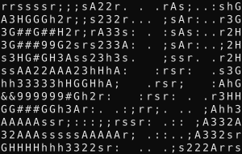
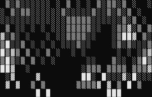
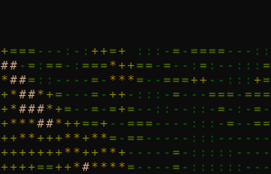

# bruhanimate

**Composable terminal animations for Python.**

[](https://pypi.org/project/bruhanimate/)
[](https://pypi.org/project/bruhanimate/)
[](https://github.com/ethanlchristensen/bruh.animate/actions/workflows/test.yml)
[](https://github.com/ethanlchristensen/bruh.animate/blob/main/LICENSE)

[Documentation](https://ethanlchristensen.github.io/bruh.animate/) ·
[Getting started](https://ethanlchristensen.github.io/bruh.animate/getting_started.html) ·
[Core concepts](https://ethanlchristensen.github.io/bruh.animate/concepts.html) ·
[Release guide](https://github.com/ethanlchristensen/bruh.animate/blob/main/docs/RELEASING.md)

Turn a simulation, drawing function, or stream of solver snapshots into an ASCII
animation. One player handles timing, input, changed-cell rendering, and terminal
cleanup, so your code can concentrate on what happens and how it looks.

- **Built-in effects:** snow, fire, rain, stars, Matrix, cellular automata, and more.
- **Layered scenes:** combine animated backgrounds, text, and custom drawings.
- **Resizable demos:** all demo `run()` entry points default to
  `on_resize="resize"`; all built-in effects adapt their simulation areas.
  Custom BaseEffect subclasses retain and clip their original rasters by default. Fixed demo artwork and window bounds keep their geometry.
- **Solver playback:** pause, step, and change speed while consuming snapshots lazily.
- **Grid helpers:** board coordinates, centered layouts, paths, markers, and clipping.

> **Version 1 is a breaking release.** The old renderer hierarchy is replaced by
> `play`, `Scene`, and `Playback`. See the [migration guide](https://ethanlchristensen.github.io/bruh.animate/migration.html).

| Plasma | Fire | Terrain |
| --- | --- | --- |
|  |  |  |

## Quick start

Requires Python 3.13 or newer. After a 1.x release is published:

```sh
python -m pip install "bruhanimate>=1,<2"
```

For unreleased code, use the [source checkout](#development). Optional audio
capture dependencies are available with `python -m pip install "bruhanimate[audio]>=1,<2"`.

Save this as `animation.py` and run `python animation.py` in a terminal:

```python
from bruhanimate import play

play("snow", preset="light", fps=60, updates_per_second=30)
```

Press **q**, **Escape**, or **Ctrl+C** to quit and restore the terminal.
`fps` controls presentation; `updates_per_second` controls simulation ticks.
Set `frames=120` to limit the number of presented frames.
Terminal output failures propagate after cleanup. On Unix, resuming a suspended
process requests a full repaint without restarting its animation.

## Browse, save, and export

```sh
bruhanimate browse
bruhanimate doctor
bruhanimate save-preset snow snow.json --preset light --seed 42 --duration 5
bruhanimate play snow --config snow.json --set wind=0.4
# Requires pip install "bruhanimate[export]":
bruhanimate export snow snow.mp4 --config snow.json --progress
```

The browser previews effects/presets with arrow keys and prints copyable Python
when you quit. Use `/` to search, `c` for categories, `e` to edit settings, `s` to
save a preset, and `x` to export after restoring the terminal. Saved JSON stores validated settings, seeds, playback rates and
capture dimensions. Explicit CLI flags override saved options. See the
[browser/configuration guide](docs/source/workbench.rst).
Generated snippets for application-defined effects require your registration code
to run first; edited settings are constructed through the registered settings type.

`Tween` adds callback-based easing for positions and effect parameters; `Theme`
shares semantic colors across widgets, panels and exports. `CachedAnimation`
reuses drawing only when you explicitly control invalidation. See
[animation tools](docs/source/animation_tools.rst) for standalone examples.

`HistoryPlayback` adds bounded backward stepping and bookmarks.
`BackgroundPlayback` keeps cooperative slow producers off the Player thread with
a bounded queue and explicit cancellation. Ordinary `Playback` still retains one
snapshot. See [solver tools](docs/source/solver_tools.rst) for ownership and limits.

`AnimationControl` adds pause, queued single-step and runtime time scaling. Choose
`mode="fixed"` for tick-based effects or `mode="continuous"` for elapsed-time
animations. `ActionQueue` keeps input commands bounded until application updates
consume them. See the [controls guide](docs/source/controls.rst), or run
`python -m bruhanimate.demos.controls_demo`.

```python
from bruhanimate import AnimationControl, Sprite, SpriteAsset

sprite = Sprite(SpriteAsset.from_text("@"), velocity=(4, 0))
control = AnimationControl(sprite, mode="continuous", paused=True, step_seconds=0.25)
control.start()
try:
    control.step()
    control.update(0)
    assert sprite.position == (1, 0)
finally:
    control.close()
```

## Editable TUI forms

`TextInput`, `Checkbox`, and `Button` add editable TUI forms with intrinsic focus
targets. `FocusStack` isolates nested modal scopes and restores prior focus when
they close. Read the [forms guide](docs/source/forms.rst), or run
`python -m bruhanimate.demos.settings_demo` for an in-memory Apply/Cancel form.

```python
from bruhanimate import FocusGroup, TextInput

field = TextInput("name", "Player", max_length=32)
focus = FocusGroup(field.focus)
field.start()
try:
    focus.handle_event(ord("q"))  # inserts text; does not quit
    assert field.value == "Playerq"
finally:
    field.close()
```

## Sprites and dynamic objects

For reusable moving objects, share immutable `SpriteAsset` / `SpriteClip` values
between independent `Sprite` instances. `ObjectGroup` owns named children and
applies add/remove/reorder commands between updates. Shapes draw directly into
Buffers with bounded clipping:

```python
from bruhanimate import ObjectGroup, Sprite, SpriteAsset, SpriteClip, capture

clip = SpriteClip([SpriteAsset.from_text(char) for char in "oO"], frame_duration=0.2)
objects = ObjectGroup({
    "left": Sprite(clip, position=(1, 1), velocity=(2, 0)),
    "right": Sprite(clip, position=(20, 2), velocity=(-2, 0)),
})
frames = []
capture(objects, width=30, height=5, frames=10, on_frame=frames.append)
```

Use `draw_line`, `draw_rect`, and `draw_ellipse` for clipped cell-space geometry.
See the [objects guide](docs/source/objects.rst) for units, timing, transparency,
ownership and input routing. Run `python -m bruhanimate.demos.objects_demo` for
a live example with dynamically added and removed sparks.

## Top-down game foundations

`TileMap` adds immutable tile definitions, visible-cell drawing and swept grid
movement. `Camera2D` provides world/screen transforms, bounded follow, and dead
zones. Game rules and input remain explicit application code:

```python
from bruhanimate import Tile, TileMap

world = TileMap(["..#.."], {".": Tile("."), "#": Tile("#", solid=True)})
position = world.move((0, 0, 1, 1), (100, 0))
assert position == (1, 0)  # stops before the wall, even for a large move
```

Run `python -m bruhanimate.demos.topdown_demo` to explore and collect stars with
arrows/WASD. See the [top-down guide](docs/source/topdown.rst) for camera,
collision, queued-input and resize behavior.

## Discover effects and presets

`light` is a named `SnowSettings` configuration: intensity `0.005`, wind `0.0`,
with collision and info display disabled. Discover the choices and their values:

```python
from bruhanimate import effects

print(effects.names())             # All registered effects
print(effects.snow.presets())      # light, moderate, blizzard, windy + settings
print(effects.snow.preset("light")) # A fresh SnowSettings copy
print(effects.snow.defaults())     # Default settings, with typed fields
```

For editor completion of effects, effect-specific presets, and settings, use
the typed catalog. It runs through the same player as `play("snow", ...)`:

```python
from bruhanimate import effects

effects.snow.play(preset="light", fps=60, updates_per_second=30, duration=10)
```

`duration` limits wall-clock seconds after startup, including paused/held time.
The first duration, frame, completion, or quit condition wins. Zero starts no
effect; `play` still opens/restores its Screen. Slow callbacks can overrun the
deadline. Built-in settings validate types, ranges, and choices before use.

Explore without writing a script or opening an animation:

```sh
bruhanimate list
bruhanimate presets snow
bruhanimate info snow
bruhanimate play snow --preset light --duration 10 --set wind=0.4
```

`python -m bruhanimate` provides the same CLI. In a source checkout, prefix either
command with `uv run --locked`. See the [discovery guide](docs/source/discovery.rst)
for configuration, CLI options, typing, and custom registry entries.

## Capture and record

Use a seed to reproduce an effect with the same settings, size, update sequence,
and dependency versions. Each effect has independent Python/NumPy randomness.
The typed catalog also exposes headless capture and recording:

```python
from bruhanimate import Frame, effects

def inspect(frame: Frame) -> None:
    print(frame.index, frame.time, frame.text())

effects.snow.capture(on_frame=inspect, preset="light", seed=42,
                     width=40, height=12, frames=4)
```

```sh
bruhanimate record snow snow.cast --preset light --seed 42 --duration 5
```

Capture uses virtual time and requires a frame or duration bound. It streams
immutable snapshots through the existing player without opening a terminal or
sleeping. `effects.snow.record("snow.cast", ...)` writes asciicast v2 files;
existing files are protected unless `overwrite=True` / `--overwrite` is set.
Live audio still requires matching external input for repeatability. See the
[capture guide](docs/source/capture.rst) for timing, ownership, and format details.

## Build a scene

Layers support `region=(x, y, width, height)` clipping and independent
`updates_per_second` rates. `TimedOverlay` shows a child for a limited duration,
then reveals the current layers beneath it. For a complete example using all
three features, run the native beam demo:

```python
from bruhanimate import beam_demo

beam_demo.run(frames=180, fps=60)
```

It combines snow at 15 updates/sec, a lazy beam solver at 5 steps/sec, a temporary
message, and a status display. Space pauses the solver, n/right steps, +/- changes
speed, and q quits. See the [composition guide](docs/source/composition.rst) for
typed API examples, clipping coordinates, timing, and ownership.

For a visual composition example, run the original v0.2 `computer` artwork with
colorful plasma inside its angled monitor and snow falling behind it. A channel
badge disappears after two seconds, then pyfiglet "bruh" cycles through Glitch,
Focus, Dissolve, and Wipe entrances over the moving plasma. Each holds for three
seconds, animates back out in reverse, then leaves a one-second gap before the next.
Playback continues until q
or the frame limit:

```python
from bruhanimate import tv_demo

tv_demo.run(frames=180, fps=60)
```

For your own scene, use
`GlitchImageEffect(text_to_image("bruh", font="small"), characters_per_second=18,
travel_time=0.65, seed=42, repeat=True, reverse=True, hold_duration=3, repeat_delay=1)`
(import both helpers from `bruhanimate`).
The typed options control launch rate, flight time in seconds, and reproducible
glitches. Resize preserves progress. Use `on_complete="hold"` to keep the background
running once it finishes. `ImageEffect(..., characters_per_second=18)` also remains
available for a simple typewriter reveal.

`FocusImageEffect(rows, duration=2, scatter=(8, 3), seed=42)` assembles scattered
characters. `DissolveImageEffect(rows, duration=2, direction="in", seed=42)` reveals
them in random order; `direction="out"` removes them. Both support the same hold,
gap, and repeat controls as Glitch.
Set `reverse=True` to retrace the effect after its hold, before the gap. Each leg
uses the same duration and seeded frames; resize preserves the current leg.

`WipeImageEffect(rows, duration=2, direction="right", reverse=True)` reveals a
straight edge across the text, then wipes it back out. `WipeDirection` offers
`"left"`, `"right"`, `"up"`, and `"down"` in editor completion.

Use `AnimationSequence` and `SequenceStep` to schedule **any animation**, with
fresh factory-created children, simulation-second durations, frozen holds, and
blank gaps. The TV demo uses this public API:

```python
from bruhanimate import AnimationSequence, SequenceStep, WipeImageEffect, play

sequence = AnimationSequence(
    SequenceStep(lambda: WipeImageEffect("bruh", duration=1, direction="right"),
                 duration=1, hold_duration=2, gap=0.5, name="Wipe right"),
    SequenceStep(lambda: WipeImageEffect("bruh", duration=1, direction="down"),
                 duration=1, hold_duration=2, gap=0.5, name="Wipe down"),
    repeat=True,
)
play(sequence, duration=12, on_resize="resize")
```

Blank sequence gaps disable descendant focus. `sequence.set_visible(False)` hides
its current and future children without pausing the timeline.

See the [sequencing guide](docs/source/sequencing.rst) for completion, skipped
steps, child ownership, and resize behavior.

Masks and styling work with **any animation**, through
`Layer(content, mask=ImageMask(rows), style=TextStyle(foreground=231),
preserve_background=True)`. Image effects operate on ASCII/text rows; `Animation`
remains the general content contract. See the [image guide](docs/source/images.rst)
for standalone examples and typed options.

```python
from bruhanimate import image_demo

image_demo.run(frames=600, fps=60)
```

This six-panel showcase compares Glitch, Focus, Dissolve, Wipe, animated plasma
painted through an image mask, and a public animation sequence. It reflows when the terminal resizes.

Or run `python -m bruhanimate.demos.tv_demo` in your terminal.
Use an 80-column by 34-row terminal to see the full artwork; resize recenters it
and smaller terminals clip safely. See [the TV demo](docs/source/demos/tv_demo.rst)
for the masked screen and layer layout.

For five windows bouncing around the terminal, including live audio:

```python
from bruhanimate import windows_demo

windows_demo.run(frames=180, fps=60, audio_mode="mirror")
```

Run `uv run --locked --extra audio python -m bruhanimate.demos.windows_demo`
for continuous playback. Plasma, fire, snow, Matrix rain, and audio Mirror move with
their frames and overlap in a fixed stacking order. Choose another typed
`audio_mode`, such as `"mirror"`, or use `None` for four windows without capture.
See [the moving windows demo](docs/source/demos/windows_demo.rst).
Windows are larger now: 36×11 cells on an 80×24 terminal, up to 60×20 on larger
terminals, including borders. They overlap as they bounce.

Use `Panel` to compose your own movable windows. `size` is the content size;
the border adds two columns and two rows. The factory receives the correct local
buffer, and typed settings/presets remain available through `effects.snow`:

```python
from bruhanimate import Panel, SnowEffect, effects, play

def build(buffer):
    return Panel(
        effect_factory=lambda local: SnowEffect(local, " ", effects.snow.preset("light")),
        size=(28, 8),
        position=(2, 2),
        velocity=(18, 3),
        bounds=(0, 0, buffer.width(), buffer.height()),
        bounce=True,
        border=True,
        title="Snow",
        updates_per_second=15,
    )

play(effect_factory=build, fps=60, updates_per_second=60, frames=180)
```

Type `Panel(` for named options and `effects.snow.preset(` for preset completion.
See the [Panel guide](docs/source/panels.rst) for clipping, transparency, and ownership.

## Build a dashboard

`Row` and `Column` allocate `Slot`s using `Fixed` cell counts or weighted `Flex`
space. Nest containers without calculating coordinates. Labels support typed
alignment, clipping, wrapping, and styling; callbacks refresh text during updates.

```python
from bruhanimate import Column, Fixed, Flex, Label, Row, Slot, Spacer, StatusBar, TextStyle, play

layout = Column(
    Slot(Label("MY DASHBOARD", align="center", style=TextStyle(bold=True)), size=Fixed(1)),
    Slot(Row(
        Slot(Label("Main content", align="center", vertical_align="middle"), size=Flex(2)),
        Spacer(Fixed(1)),
        Slot(Label(lambda: "State: ready", overflow="ellipsis"), size=Fixed(16)),
    )),
    Slot(StatusBar("Ready", right="q quit", style=TextStyle(background=24)), size=Fixed(1)),
    padding=1,
    gap=1,
)
play(effect_factory=layout.build, fps=60, frames=180, on_resize="resize")
```

Use `Slot(effect_factory=...)` for animations that need an allocated local buffer.
Type `Label(..., align=...)` or `overflow=...` for editor choices. Layout trees
are single-use; create a new tree for another run. See the
[layout and text guide](docs/source/layouts.rst) for sizing, ownership, and callbacks.

Run `python -m bruhanimate.demos.dashboard_demo` for a beam solver, live statistics,
snow background, plasma preview, and an activity log. Tab/Shift+Tab selects a panel;
Space pauses the solver or signal. In the solver, n steps and +/- changes speed; in the signal
panel, r remixes plasma. The focused border and status hints show where keys go.
Arrows/Page Up/Down/Home/End scroll the solver or log. Scrolling upward in the log
suspends following new messages; End resumes it. The log records solver progress
and control actions, with bounded history.
q quits. Resize the terminal while paused to see the layout reflow
without losing the solver snapshot or queued steps. See the [dashboard demo](docs/source/demos/dashboard_demo.rst).

## Keyboard bindings and focus

Named keys are Literal-typed for editor completion. Character shortcuts use
`KeyBinding.character(...)`. Attach a target to each interactive panel, then pass
the group's handler to the existing player:

```python
from bruhanimate import (
    Column, Fixed, FocusGroup, FocusTarget, KeyBinding, KeyBindings,
    Label, Panel, Slot, StatusBar, play,
)

state = {"count": 0}

def increment() -> None:
    state["count"] += 1

counter = FocusTarget("counter", KeyBindings(
    KeyBinding("space", increment, description="increment"),
))
focus = FocusGroup(counter)
layout = Column(
    Slot(Panel(Label(lambda: f"Count: {state['count']}"),
               size=(20, 3), fit=True, title="Counter", focus=counter)),
    Slot(StatusBar("counter", center=focus.help_text, right="q quit"), size=Fixed(1)),
)
play(effect_factory=layout.build, event_handler=focus.handle_event,
     frames=180, on_resize="resize")
```

Add more targets to `FocusGroup` to navigate with Tab/Shift+Tab. Bindings expose
typed `hints()` and `help_text()` so help stays aligned with actions. Actions return
None and consume their key; `quit=True` explicitly requests exit. FocusGroup adds
q/Q, Escape, and Ctrl+C as global fallback quit keys. Hidden or disabled targets
are skipped, and showing a panel does not steal focus. See the
[keyboard guide](docs/source/keyboard.rst) for custom navigation, global bindings,
visibility, and `EventResult` for custom routing.

## Scrollable content and logs

`ScrollView(animation, size=(40, 8), content_size=(100, 60))` owns an animation on
a larger canvas. Its viewport resizes without restarting the child or consuming
solver snapshots. `LogView` stores bounded text history and exposes the same
scrolling controls:

```python
from bruhanimate import (
    Column, Fixed, FocusGroup, FocusTarget, LogView, Panel, Slot, StatusBar, play,
)

log = LogView(size=(40, 6), max_lines=200, wrap="character", follow_tail=True)
log.append("Ready\n" + "\n".join(f"Activity {i}" for i in range(20)))
target = FocusTarget("activity", log.bindings)
focus = FocusGroup(target)
layout = Column(
    Slot(Panel(log, size=(40, 6), fit=True, title="Activity", focus=target)),
    Slot(StatusBar(lambda: "LIVE" if log.follow_tail else "HISTORY",
                   center=focus.help_text, right="q quit"), size=Fixed(1)),
)
play(effect_factory=layout.build, event_handler=focus.handle_event,
     on_resize="resize", frames=180)
```

Append messages from actions or updates. `wrap` offers typed `"character"` and
`"none"` choices; `TextStyle` controls colors. Upward scrolling preserves your place
as messages arrive; End or `log.follow_tail = True` returns to the newest messages.
`max_lines` counts logical lines, and evicts the oldest excess lines. The
[scrolling guide](docs/source/views.rst) covers resize anchoring, navigation,
ownership, and an interactive append example.

## Board highlights and playable exports

`PathEffect` moves a marker along supplied cells or traces the route. `PulseEffect`
brightens a cell; `RippleEffect` expands a circle, diamond, or square. All use board
coordinates and follow centered placement on resize. Editor completion exposes
`PathMode`, `RippleMetric`, and their constructor options.

```python
from bruhanimate import PathEffect, play

play(PathEffect([(0, 0), (1, 0), (2, 0)], size=(3, 1), mode="trace",
                duration=2, hold_duration=1, repeat=True),
     duration=5, on_resize="resize")
```

Run the complete example with `python -m bruhanimate.demos.routing_demo`.
See the [motion guide](docs/source/motion.rst) for timing and composition.

`save_svg(frame, path)` needs no extra dependencies. Install
`pip install "bruhanimate[export]"` for `save_png` and `export_animation` (GIF/MP4).
`ExportStyle` exposes font, cell size, and RGB colors. Raster text uses a shared
baseline; pass a font file explicitly to match your terminal's font.
`ExportFormat` exposes the
animation formats. MP4 uses the bundled FFmpeg executable on supported platforms.

```python
from pathlib import Path
from tempfile import TemporaryDirectory
from bruhanimate import capture, save_svg

frames = []
capture("plasma", on_frame=frames.append, frames=1, width=30, height=10)
with TemporaryDirectory() as directory:
    save_svg(frames[0], Path(directory) / "plasma.svg")
```

For a persistent video after installing the extra:

```sh
python -c "from bruhanimate import export_animation; export_animation('plasma.mp4', 'plasma', duration=5, fps=30)"
```

Export owns its animation and requires a finite frame/duration bound. Existing
files require `overwrite=True`. GIF buffers a bounded number of pixels; MP4
streams frames. The [export guide](docs/source/exports.rst) covers these limits,
font selection, and exporting your own scenes without a terminal.

## Live terminal resize

Live resize is opt-in with `on_resize="resize"` on `play`, `Player`, or
`effects.snow.play`. Editors suggest both `"raise"` (the existing default) and
`"resize"` through `ResizePolicy`. Layouts reflow; `Panel(..., fit=True)` follows
its parent's allocation. Snow piles and fire follow the new bottom; plasma fills
the new area at its current phase. Rain preserves drops and lightning lifetimes,
and Matrix preserves characters and row timing. Cropped state is discarded;
all built-ins now adapt their simulation dimensions. Grids retain cell state,
particles retain velocities, and audio keeps its capture worker. Custom
animations can implement the same typed `Resizable.resize((width, height))` hook. See the
[resize guide](docs/source/resize.rst) for lifecycle and platform details.

```python
from bruhanimate import effects

effects.fire.play(on_resize="resize", fps=60, updates_per_second=30, frames=180)
# The same option is available on effects.rain.play() and effects.matrix.play().
```


Put a title over an animated background:

```python
from bruhanimate import ImageEffect, Scene, effect_registry, play


def build(buffer):
    snow = effect_registry.create("snow", buffer, " ", preset="light")
    return Scene(snow, ImageEffect("Advent of Code"))


play(effect_factory=build, fps=60, updates_per_second=30)
```

The factory receives a screen-sized buffer. A scene paints its children from back
to front, and `ImageEffect` centers text by default. Use
`Layer(animation, transparent=True)` when plain spaces should reveal lower layers;
`None` cells are always transparent.

## Animate a solver

Yield snapshots from your solver and describe how to draw one:

```python
from bruhanimate import Playback, draw_grid, play

board = ("S...", ".##.", "...E")


def states():
    yield from ((0, 0), (1, 0), (2, 0), (3, 0), (3, 1), (3, 2))


def draw(position, buffer):
    grid = draw_grid(buffer, board, spacing=(2, 1))
    grid.put(*position, "@")


animation = Playback(states(), draw, steps_per_second=5)
play(animation, fps=60, event_handler=animation.handle_event, on_complete="hold")
```

**Space** pauses, **n/right arrow** steps, **+/-** changes speed, and **q** quits.
The final state stays visible; use `on_complete="exit"` to close automatically.
Yield independent snapshots, and keep the work between yields short enough for
responsive input. Playback keeps the current snapshot and closes its iterator on
completion or early quit.

## Choose the right building block

| You want to… | Start with |
| --- | --- |
| Run a built-in effect | `play("fire")` or a named preset |
| Write a small custom animation | `CallbackEffect(draw, update=update)` |
| Keep a persistent simulation raster | Subclass `BaseEffect` and implement `update(dt)` |
| Combine backgrounds, labels, and overlays | `Scene`, `Layer`, and `ImageEffect` |
| Pan a board or larger animation canvas | `ScrollView` |
| Browse bounded activity history | `LogView` |
| Route keys to a selected panel | `FocusTarget` and `FocusGroup` |
| Animate a solver or recorded states | `Playback` and `draw_grid` |
| Supply your own Screen or clock | `Player` |

Change state in `update(dt)` and read it in `draw(buffer)`. The player owns the
loop; animations own their state. The [core-concepts guide](https://ethanlchristensen.github.io/bruh.animate/concepts.html)
walks through this division with complete examples.

## Flow trails, branching growth, and star flight

Three effects add nine presets, all available in the effect browser and CLI:

| Effect | Presets | Visual |
| --- | --- | --- |
| `flow` | `neon`, `ocean`, `ember` | Curling particles with fading trails |
| `growth` | `coral`, `forest`, `electric` | Branching shoots and overlapping generations |
| `starfield` | `drift`, `warp`, `spiral` | Perspective star flight, streaks, and rotation |

```python
from bruhanimate import effects

effects.starfield.play(
    preset="warp", seed=42, fps=60, updates_per_second=30, on_resize="resize"
)
```

Run `python -m bruhanimate.demos.flow_demo` (or `growth_demo`, `starfield_demo`)
for a standalone demo. Configure `FlowSettings`, `GrowthSettings`, or
`StarfieldSettings` to change particle budgets, speed, fading and branching.
These effects need no additional dependencies. They use simulation ticks,
support seeded capture and live resize, and keep drawing separate from updates.
See the [creative effects guide](docs/source/creative_effects.rst) for settings,
units, composition and resize contracts.

For a spaceship flying through warp with animated engine flames:

```sh
uv run --locked python -m bruhanimate.demos.warp_demo
```

The ship drifts automatically and adapts to smaller terminals. Press q or Escape
to quit. See the [warp demo](docs/source/demos/warp_demo.rst).

## Water, smoke, cloth, and procedural worlds

Run all six together in resizable panels:

```sh
python -m bruhanimate.demos.nature_demo
```

| Effect | Presets | What it does |
| --- | --- | --- |
| `water` | `pond`, `rain`, `storm` | Interacting ripples and reflecting edges; inject your own drops |
| `diffusion` | `coral`, `spots`, `stripes`, `organic` | Reaction–diffusion; `organic` adds shaded, scattered patterns |
| `smoke` | `plume`, `ink`, `windy` | Rising smoke or sinking ink, with optional solid obstacles |
| `metaballs` | `lava`, `orbit`, `outline` | Moving blobs that merge into shared surfaces |
| `cloth` | `flag`, `checker`, `banner` | Waving cloth carrying a pattern, text, or your ASCII art |
| `terrain` | `hills`, `mountains`, `contours` | A perspective flyover of seeded terrain |

```python
from bruhanimate import effects

print(effects.names())
print(effects.water.presets())
settings = effects.water.preset("pond")
settings.drop_chance = 0.2
effects.water.play(settings=settings, fps=60, updates_per_second=30,
                   duration=10, on_resize="resize")
```

Editors complete `effects.water`, preset names, and `WaterSettings` fields;
the same typed catalog is available for every effect above. Each has a standalone
demo (`python -m bruhanimate.demos.cloth_demo`, for example). No audio dependency
is needed. Smoke uses an artistic flow field and cloth uses traveling waves.
See the [natural effects guide](docs/source/natural_effects.rst) for controls,
custom cloth art, units, and resize behavior.

## Optional audio visualizations

From a checkout, run `uv run --locked --extra audio python -m bruhanimate.demos.audio_demo`
while music is playing. Left/right arrows select the previous/next visualization
with no automatic cycling; q quits. See the
[audio demo guide](docs/source/demos/audio_demo.rst).

The audio demo plays inside the original computer artwork with snow behind it;
press **C** to cycle classic, expanded artwork, and a rectangular computer.
Expanded inserts middle sections to give the monitor more room while keeping
the original corners and keyboard. Small terminals use the rectangular frame
automatically. Arrow keys still select modes, and resize/style changes preserve
capture and snow. Use `run(computer="expanded")` from
`bruhanimate.demos.audio_demo` to start with the larger artwork.

The audio demo starts with **Objects**, a field of blocks across the monitor:
bass grows them from 3×3 cells until they touch and fill the viewport, mids move
them within the remaining space, treble adds sparkles, and volume sets brightness.
The seven supported modes are `objects`, `tiles`, `glow`, `bars`, `mirror`,
`waveform`, and `spectrum`. Tiles lights frequency blocks across the screen; Glow
blends bass, mids, and treble into moving pools of color. `AudioSettings` exposes typed mode choices,
`sensitivity`, `smoothing`, `noise_floor`, and `bar_gain`; `effects.audio.presets()` lists presets.
Bars/Mirror default to `bar_gain=2` for taller bars; use `1` for the original
height or increase it for more screen coverage. The demo also fills column gaps.
Frequency bands sum energy so quieter mids and diffuse treble remain visible
beside bass. The default `noise_floor=-65` retains quiet detail; raise it to
`-55` or `-40` to suppress more background noise.
Experimental modes were removed from the API—see the
[audio migration notes](docs/source/bruheffect/audio_effect.rst#removed-modes-in-1-3).

## Explore the demos

```sh
python -m bruhanimate.demos.snow_demo
python -m bruhanimate.demos.fire_demo
python -m bruhanimate.demos.shared_player_demo
python -m bruhanimate.demos.grid_demo
```

From a uv source checkout, prefix these commands with `uv run --locked`.
The grid demo includes a complete BFS solver, animated background, status text,
and playback controls. Demos expose `run(frames=None, fps=...)` for use from Python.

## Documentation

| Guide | What it covers |
| --- | --- |
| [Getting started](https://ethanlchristensen.github.io/bruh.animate/getting_started.html) | Installation, first animation, and demos |
| [Core concepts](https://ethanlchristensen.github.io/bruh.animate/concepts.html) | Player, state, buffers, composition, and solver snapshots |
| [Player and composition](https://ethanlchristensen.github.io/bruh.animate/player.html) | Timing, lifecycle, ownership, and the API |
| [Image effects](docs/source/images.rst) | Glitch, Focus, Dissolve, Wipe, masks, and styling |
| [Animation sequences](docs/source/sequencing.rst) | Timed factories, holds, gaps, completion, and ownership |
| [Resize](docs/source/resize.rst) | Layout reflow and built-in state preservation |
| [Rendering performance](docs/source/performance.rst) | CPU and native terminal benchmarks |
| [Release 1.3.0](docs/source/release_1_3.rst) | Features and upgrade notes |
| [Solver playback](https://ethanlchristensen.github.io/bruh.animate/playback.html) | Pause, stepping, completion, and bounded solver work |
| [Migration to 1.0](https://ethanlchristensen.github.io/bruh.animate/migration.html) | Replacing the 0.2.x renderer APIs |
| [Release process](https://ethanlchristensen.github.io/bruh.animate/releasing.html) | Dev-to-main workflow, versions, tags, and publishing |

Live terminal reflow is available with `on_resize="resize"`; all demos enable it
by default. Headless capture, `.cast` recording, SVG/PNG snapshots, and GIF/MP4
export are supported. See the [native checks guide](docs/source/platform_checks.rst)
for terminal and optional audio validation.
The terminal demo is a pipe-based command console, not a PTY emulator.

Changes in 1.6.0 are described in the [migration notes](docs/MIGRATING_1.6.md).

## Development

For repeatable CPU measurements, run
`uv run --locked python scripts/benchmark_rendering.py --output benchmark.json`.
See the [rendering performance guide](docs/source/performance.rst) for methodology
and interpretation; these measurements exclude native terminal I/O.

Use Python 3.13 and uv 0.13.4, pinned in `pyproject.toml`:

```sh
git clone https://github.com/ethanlchristensen/bruh.animate.git
cd bruh.animate
git switch dev
uv sync --locked --group docs
uv run --locked ruff check .
uv run --locked mypy
uv run --locked pytest
uv run --locked python scripts/check_examples.py
uv run --locked --group docs python scripts/build_docs.py
```

Install uv with `python -m pip install uv==0.13.4`, or update an existing standalone
installation with `uv self update 0.13.4`. Sync installs this checkout in editable
mode. Open `docs/build/html/index.html` to preview the documentation.

Read [AGENTS.md](https://github.com/ethanlchristensen/bruh.animate/blob/main/AGENTS.md)
for architecture, lifecycle rules, and contribution checks. CI tests Linux,
Windows, and macOS and smoke-tests installed wheel/source distributions.

## Releases

**Work on dev → merge into main → wait for green CI → push a matching version tag.**

A merge updates the documentation site. Pushing `vMAJOR.MINOR.PATCH` starts package
validation and publishing to PyPI, followed by a GitHub release. The preparation
helper previews by default and never creates a tag:

```sh
# Check the currently prepared version; no version or Git changes:
uv run --locked python publish.py --check
```

Follow the [complete release checklist](https://github.com/ethanlchristensen/bruh.animate/blob/main/docs/RELEASING.md)
for version/lockfile agreement, authentication setup, tag commands, and recovery.

## License

[Apache 2.0](https://github.com/ethanlchristensen/bruh.animate/blob/main/LICENSE).
Created by Ethan Christensen, with inspiration from
[Asciimatics](https://github.com/peterbrittain/asciimatics).
